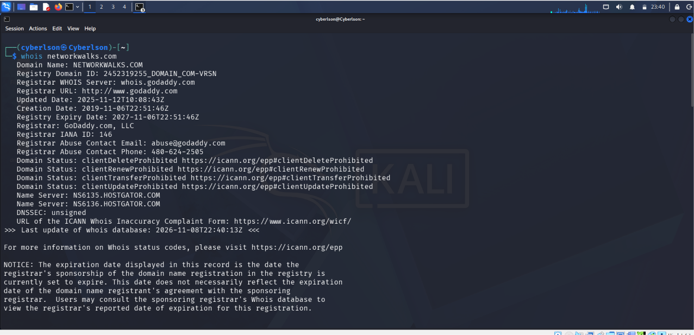
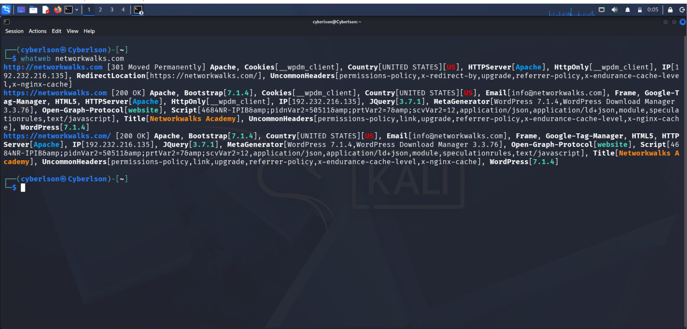
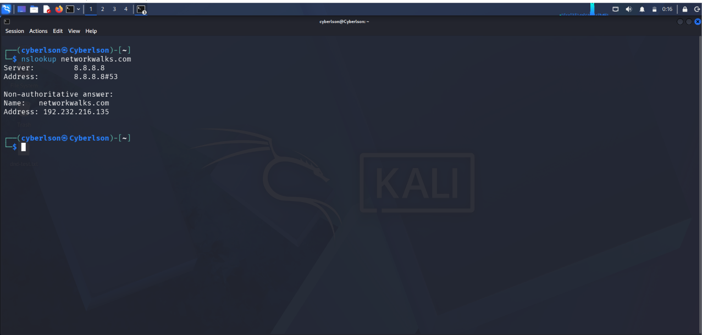
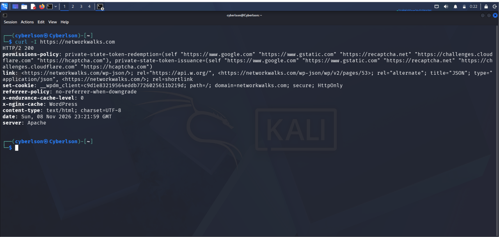
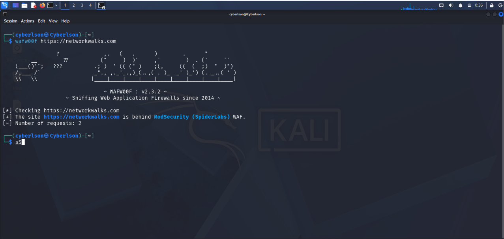
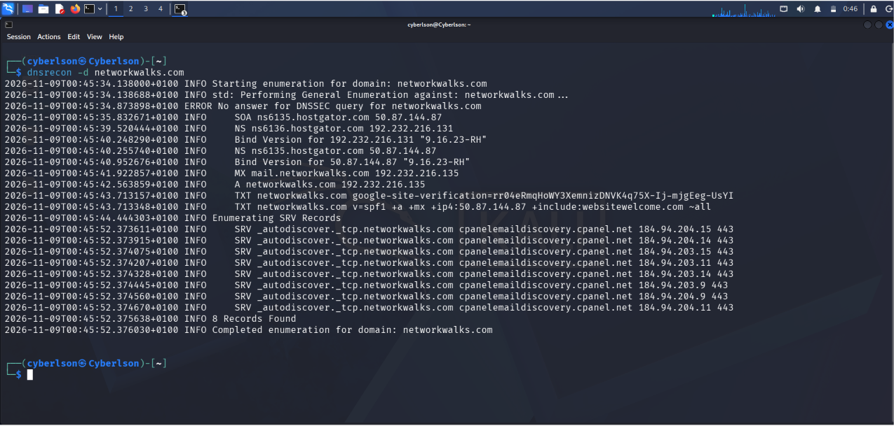

# W2-PM1 — Website Footprinting Using Kali Linux Tools

**Networkwalks Cybersecurity Internship | Week 2 | Project Module 1**

**Intern:** Abdulmajid Bello  
**Batch:** B0840  
**Target:** `networkwalks.com`  
**Operating System:** Kali Linux  
**Assessment Dates:** November 8–9, 2026  
**Project Type:** Website Footprinting and Reconnaissance

---

## 1. Project Overview

This project documents a website footprinting exercise conducted as part of the Networkwalks Cybersecurity Internship.

The objective was to collect publicly observable technical information about the assigned domain using six Kali Linux tools.

The exercise focused on domain registration, web technologies, DNS resolution, HTTP headers, Web Application Firewall detection, and DNS infrastructure.

**Tools used:**

1. WHOIS
2. WhatWeb
3. NSLookup
4. cURL
5. WAFW00F
6. DNSRecon

The assessment was limited to reconnaissance and information gathering. No exploitation, credential testing, or attempts to bypass security controls were performed.

All testing must remain within the scope approved by the internship organizers.

## 2. Objectives

- Identify domain registration details.
- Discover technologies associated with the target website.
- Resolve the domain to its IPv4 address.
- Examine HTTP response headers and security-related configurations.
- Detect potential Web Application Firewall protection.
- Enumerate publicly available DNS records.
- Document findings with reproducible commands and screenshots.

---

## 3. Task 1 — Domain Registration Analysis Using WHOIS

### Command

```bash
whois networkwalks.com
```

**Purpose:** WHOIS retrieves publicly available domain registration and registrar information.

### Findings

| Parameter | Result |
|---|---|
| Domain | networkwalks.com |
| Registrar | GoDaddy.com, LLC |
| Creation Date | November 6, 2019 |
| Updated Date | November 12, 2025 |
| Registry Expiry Date | November 6, 2027 |
| Registry Name Server 1 | ns6135.hostgator.com |
| Registry Name Server 2 | ns6136.hostgator.com |
| Registrant Information | Privacy protected |
| DNSSEC | Unsigned |

The registry and registrar WHOIS responses contained slightly different name server listings. Further DNS enumeration was used to examine the domain's published name servers.

### Security Significance

WHOIS provides registration and infrastructure context that can help security analysts understand a domain's administrative background.

These results are informational and do not indicate a confirmed vulnerability.

### Evidence



---

## 4. Task 2 — Web Technology Fingerprinting Using WhatWeb

### Command

```bash
whatweb networkwalks.com
```

**Purpose:** WhatWeb identifies web technologies and other characteristics observable from HTTP responses.

### Findings

| Technology / Information | Observed Result |
|---|---|
| Web Server | Apache |
| Content Management System | WordPress |
| Reported WordPress Version | 7.1.4 |
| WordPress Plugin | Download Manager 3.3.76 |
| JavaScript Library | jQuery 3.7.1 |
| Analytics / Tagging | Google Tag Manager |
| IPv4 Address | 192.232.216.135 |
| HTTP Response | 301 Moved Permanently |
| HTTPS Response | 200 OK |
| Page Title | Networkwalks Academy |

The HTTP endpoint redirected to HTTPS, and the HTTPS endpoint returned a successful response.

WhatWeb reported WordPress and several associated technologies. The reported version numbers are fingerprinting results and require independent confirmation before drawing security conclusions.

### Security Significance

Technology fingerprinting helps an analyst understand the apparent application stack and identify areas for further authorized review.

No vulnerability was confirmed by this command.

### Evidence



---

## 5. Task 3 — DNS Resolution Using NSLookup

### Command

```bash
nslookup networkwalks.com
```

**Purpose:** NSLookup queries DNS to resolve a domain name to an IP address.

### Findings

| Parameter | Result |
|---|---|
| Domain | networkwalks.com |
| DNS Resolver | 8.8.8.8 |
| Resolver Provider | Google Public DNS |
| IPv4 Address | 192.232.216.135 |
| Response Type | Non-authoritative |

The returned address matched the IPv4 address previously reported by WhatWeb.

### Security Significance

DNS resolution helps analysts establish relationships between domain names and the IP addresses observed during an assessment.

The matching results strengthened confidence in the IP observation at the time of testing.

### Evidence



---

## 6. Task 4 — HTTP Header Analysis Using cURL

### Command

```bash
curl -I https://networkwalks.com
```

**Command Explanation:**

- `curl` — Sends requests and retrieves information using supported protocols.
- `-I` — Requests HTTP response headers using a HEAD request.
- `https://networkwalks.com` — Specifies the target HTTPS endpoint.

### Findings

| HTTP Header / Property | Observed Result |
|---|---|
| HTTP Status | HTTP/2 200 |
| Server | Apache |
| Content Type | text/html; charset=UTF-8 |
| WordPress REST API | Advertised through Link header |
| Cookie | __wpdm_client |
| Cookie Secure Attribute | Present |
| Cookie HttpOnly Attribute | Present |
| Referrer-Policy | no-referrer-when-downgrade |
| Permissions-Policy | Present |
| Cache-related Headers | x-endurance-cache-level, x-nginx-cache |

The HTTP headers confirmed that the website responded successfully over HTTPS.

The `Secure` and `HttpOnly` cookie attributes were present, providing useful browser-side protections.

Several commonly recommended security headers, including Strict-Transport-Security, Content-Security-Policy, and X-Content-Type-Options, were not visible in this particular response.

### Security Significance

HTTP headers provide information about server behavior, browser security controls, caching, and cookie handling.

The observations may support a later configuration review, but they do not independently demonstrate an exploitable weakness.

**Evidence handling:** Cookie values were excluded or redacted from publicly shared evidence.

### Evidence



---

## 7. Task 5 — Web Application Firewall Detection Using WAFW00F

### Command

```bash
wafw00f https://networkwalks.com
```

**Purpose:** WAFW00F uses HTTP fingerprinting techniques to identify potential Web Application Firewall products.

### Findings

| Parameter | Result |
|---|---|
| Tool | WAFW00F |
| Version | 2.3.2 |
| Target | https://networkwalks.com |
| Detected WAF | ModSecurity (SpiderLabs) |
| Requests Reported | 2 |

WAFW00F identified a fingerprint consistent with ModSecurity.

### Security Significance

A Web Application Firewall may help inspect and filter potentially malicious HTTP requests.

However, detection of a WAF does not establish how effectively the firewall is configured or whether it blocks all relevant attack patterns.

The result should be treated as a tool-based identification rather than a complete verification of security controls.

### Evidence



---

## 8. Task 6 — DNS Enumeration Using DNSRecon

### Command

```bash
dnsrecon -d networkwalks.com
```

**Command Explanation:**

- `dnsrecon` — Performs DNS reconnaissance and enumeration.
- `-d` — Specifies the target domain.
- `networkwalks.com` — Domain under examination.

### Findings

| DNS Record / Information | Observed Result |
|---|---|
| SOA Primary Name Server | ns6135.hostgator.com |
| NS Record 1 | ns6135.hostgator.com |
| NS Record 2 | ns6136.hostgator.com |
| A Record | 192.232.216.135 |
| MX Record | mail.networkwalks.com |
| TXT Record | Google site verification |
| SPF Record | Present, ending with `~all` |
| SRV Service | _autodiscover._tcp.networkwalks.com |
| SRV Destination | cpanelemaildiscovery.cpanel.net |
| BIND Version String | 9.16.23-RH |
| DNSSEC Query | No answer returned |

DNSRecon also identified the following name server addresses:

- `ns6135.hostgator.com` — `50.87.144.87`
- `ns6136.hostgator.com` — `192.232.216.131`

The tool returned eight SRV records associated with the email autodiscovery service.

Although DNSRecon reported no answer for its DNSSEC query, the overall enumeration completed successfully.

### Security Significance

DNS enumeration provides a broader understanding of a domain's public infrastructure, including website hosting, authoritative DNS, and email-related records.

The reported BIND version is an identification result and does not establish that the servers are vulnerable.

No exploitation or unauthorized access was attempted.


### Evidence — DNSRecon Enumeration

The screenshot below shows the DNSRecon enumeration performed against the assigned domain.


---

## 9. Consolidated Results

| Tool | Primary Finding | Status |
|---|---|---|
| WHOIS | GoDaddy registrar and domain registration details | Completed |
| WhatWeb | Apache, WordPress and associated technologies | Completed |
| NSLookup | Domain resolved to 192.232.216.135 | Completed |
| cURL | HTTP/2 response and security-related headers | Completed |
| WAFW00F | ModSecurity WAF fingerprint detected | Completed |
| DNSRecon | DNS, mail and service records enumerated | Completed |

**Total tasks completed: 6 of 6**

## 10. Key Technical Observations

1. The target domain resolved consistently to `192.232.216.135` across WhatWeb, NSLookup and DNSRecon.
2. HTTP requests were redirected to HTTPS.
3. WhatWeb identified Apache and WordPress-related technologies.
4. The HTTP response included `Secure` and `HttpOnly` cookie attributes.
5. WAFW00F identified ModSecurity as a likely Web Application Firewall.
6. DNSRecon revealed public DNS and email-related records.
7. The WHOIS and DNSRecon results provided complementary information about the domain's name servers.

These are primarily informational observations. The project did not establish any confirmed exploitable vulnerability.

## 11. Limitations

- Results reflect the target's observable state during testing on November 8–9, 2026.
- Public DNS records and IP addresses can change over time.
- Automated fingerprinting may produce inaccurate or incomplete technology identifications.
- A WAF detection does not verify its effectiveness.
- Header analysis was limited to the captured response.
- No intrusive security testing, vulnerability exploitation, or authentication testing was performed.
- The findings should not be interpreted as a complete penetration test.

## 12. Lessons Learned

This project strengthened my practical understanding of passive and lightweight active reconnaissance using Kali Linux.

I learned how to:

- Interpret domain registration information.
- Identify publicly observable web technologies.
- Resolve DNS names to IPv4 addresses.
- Analyse HTTP response headers.
- Understand WAF fingerprinting results.
- Investigate public DNS infrastructure.
- Cross-check findings from different tools.
- Distinguish informational findings from confirmed vulnerabilities.
- Maintain screenshot-based evidence for technical reporting.

## 13. Conclusion

W2-PM1 was completed successfully using all six required Kali Linux footprinting tools.

The exercise provided useful insight into the target's publicly observable domain registration, web technologies, network addressing, HTTP configuration, WAF fingerprint, and DNS infrastructure.

Cross-verification between multiple tools improved the reliability of the observations, while careful interpretation helped avoid unsupported security claims.

The practical work and collected evidence provide a foundation for subsequent authorized security assessment activities.

---

**Prepared by:** Abdulmajid Bello  
**Internship:** Networkwalks Cybersecurity Internship  
**Batch:** B0840  
**GitHub:** [cYBerLson](https://github.com/cYBerLson)

*For authorized cybersecurity education, technical documentation, and defensive security research.*