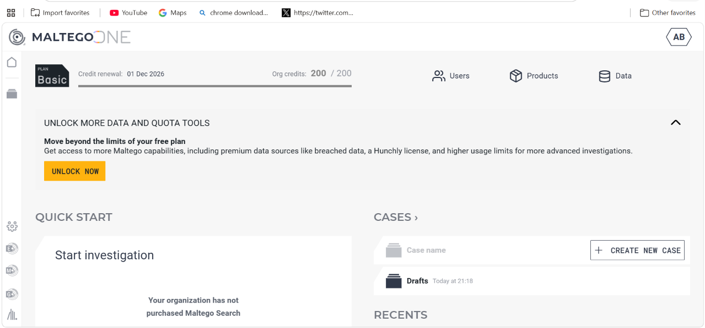
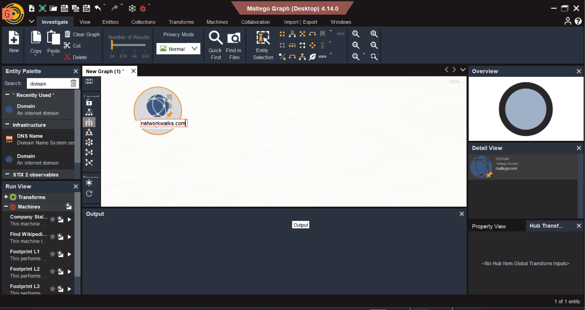
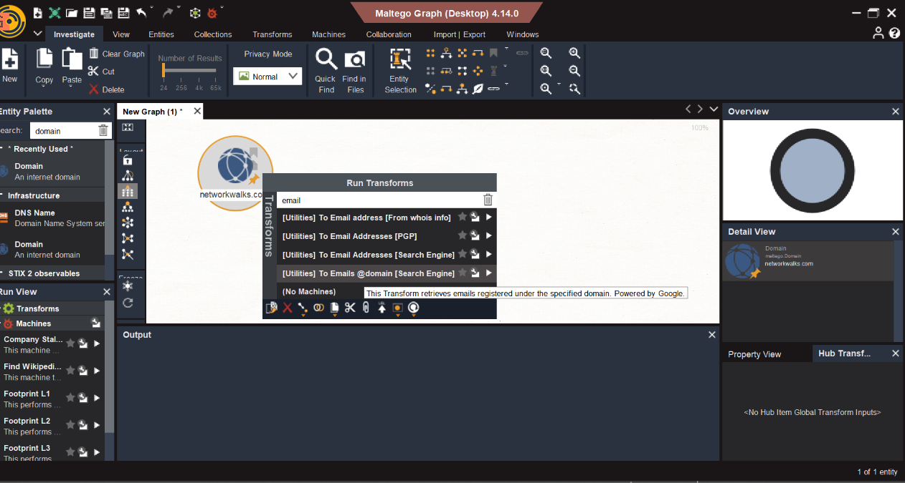

# W2-PM3 — Footprinting and Reconnaissance with Maltego

**Networkwalks Cybersecurity Internship | Week 2 | Project Module 3**

**Intern:** Abdulmajid Bello  
**Intern ID:** NW-084-2ST  
**Batch:** B0840  
**Assessment Date:** November 9, 2026  
**Operating System:** Windows 11  
**Software:** Maltego Graph (Desktop) 4.14.0  
**Target Domain:** `networkwalks.com`

---

## 1. Project Overview

This project documents a footprinting and open-source intelligence (OSINT) exercise performed using Maltego as part of the Networkwalks Cybersecurity Internship.

The project involved two tasks assigned by the instructor:

1. Download and install Maltego on a Windows computer.
2. Identify email addresses associated with `networkwalks.com` using Maltego.

The objective was to understand how Maltego uses entities, transforms, and graph relationships to organize publicly discoverable information.

The exercise focused on information gathering and visualization. No exploitation, credential testing, or unauthorized access was performed.

## 2. Task 1 — Download and Install Maltego

### Objective

Install and configure Maltego on a Windows computer.

### Procedure

1. Visited the official Maltego website: https://www.maltego.com/
2. Downloaded the Windows installation package.
3. Installed Maltego on the Windows host.
4. Launched the application.
5. Completed the initial account and application configuration.
6. Confirmed that Maltego was ready to create graphs and execute transforms.

### Result

Maltego Graph (Desktop), version 4.14.0, was successfully installed and launched on Windows.

### Evidence



---

## 3. Task 2 — Identify Email Addresses Associated with networkwalks.com

### Objective

Use Maltego to discover publicly available email addresses related to the assigned domain.

### Target

`networkwalks.com`

### Procedure

**Step 1 — Create a New Graph**

Opened Maltego and created a new investigation graph.

**Step 2 — Add a Domain Entity**

Searched for the Domain entity in the Entity Palette and added it to the graph.

Configured the entity value as:

`networkwalks.com`



**Step 3 — Execute an Email-Related Transform**

Selected the domain entity and ran the following transform:

**Utilities — To Emails @domain (Search Engine)**

The transform searched for publicly discoverable email information associated with the domain.



**Step 4 — Examine the Results**

After the transform completed, Maltego displayed an email entity connected to the original domain.

### Actual Findings

| Parameter | Observed Result |
|---|---|
| Target domain | networkwalks.com |
| Transform | To Emails @domain (Search Engine) |
| Email discovered | info@networkwalks.com |
| Email entities returned | 1 |
| Total graph entities | 2 |
| Graph relationships | 1 |
| Execution status | Completed successfully |

### Result Interpretation

The graph contained two entities:

- A Domain entity representing `networkwalks.com`.
- An Email Address entity representing `info@networkwalks.com`.

One graph relationship connected the discovered email address to the target domain.

The finding demonstrates that Maltego can represent publicly discoverable information as interconnected entities.

The result does not establish that this is the only email address associated with the organization.

### Evidence


---

## 4. Graph Analysis

Maltego's graphical representation made it easier to understand the relationship between the target domain and the discovered email address.

**Domain entity:** Represents the organization-related internet domain.

**Email entity:** Represents the publicly discoverable email address returned by the transform.

**Relationship:** Shows the association identified by the selected information-gathering transform.

The graph is useful for visualizing reconnaissance findings and documenting how information was discovered.

## 5. Security Significance

Maltego supports cybersecurity investigations by organizing information collected from publicly accessible sources.

Security analysts may use such information to:

- Understand an organization's publicly visible digital footprint.
- Identify organization-related contact information.
- Visualize relationships between domains and other entities.
- Support authorized attack-surface assessments.
- Identify information exposure that may warrant defensive review.

A publicly available organizational email address is not automatically a security vulnerability.

The assessment did not involve sending emails, collecting credentials, or attempting to access accounts.

## 6. Challenges and Limitations

- Transform results depend on the information sources available at the time of execution.
- A successful transform does not guarantee complete coverage of all associated email addresses.
- Free Maltego functionality may have usage limits.
- Some transforms require additional providers or configuration.
- Information gathered from public sources may be incomplete or outdated.
- No independent verification of mailbox ownership or deliverability was performed.

## 7. Project Evidence

```text
03-maltego/
├── README.md
├── maltego-graph [native Maltego file]
└── screenshots/
    ├── W2-PM3-01-maltego-installation.png
    ├── W2-PM3-02-domain-entity.png
    ├── W2-PM3-03-email-transform.png
    └── W2-PM3-04-email-results.png
```

The original investigation graph was saved in Maltego's native format for future inspection.

The screenshots document the installation, configured domain entity, transform execution, and discovered email relationship.

## 8. Lessons Learned

Through this project, I gained practical experience in:

1. Installing and configuring Maltego on Windows.
2. Creating an investigation graph.
3. Working with Domain and Email Address entities.
4. Executing an email-related transform.
5. Interpreting relationships between discovered entities.
6. Understanding the limitations of automated OSINT collection.
7. Saving graph-based evidence for technical reporting.
8. Distinguishing publicly available information from confirmed security vulnerabilities.

## 9. Conclusion

Both assigned W2-PM3 tasks were completed successfully.

Maltego Graph (Desktop) 4.14.0 was installed on Windows, and an OSINT investigation was performed using the assigned domain, `networkwalks.com`.

The selected email-related transform returned one email address, `info@networkwalks.com`, displayed as a connected entity in the investigation graph.

This exercise strengthened my understanding of graphical reconnaissance, entity relationships, OSINT workflows, and professional cybersecurity documentation.

---

**Prepared by:** Abdulmajid Bello  
**Intern ID:** NW-084-2ST  
**Batch:** B0840  
**GitHub:** [cYBerLson](https://github.com/cYBerLson)

*For authorized cybersecurity education and defensive security research.*