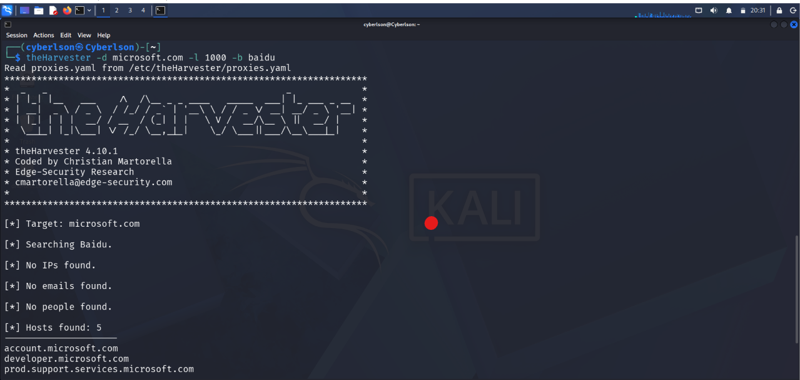
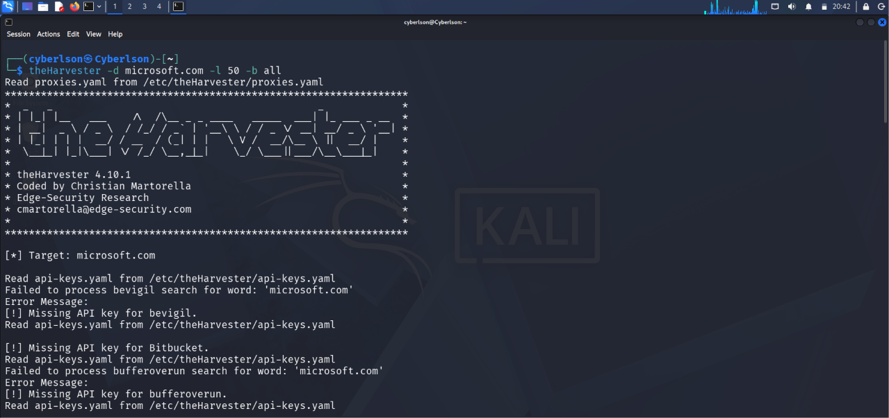

# W2-PM4 — Footprinting and Reconnaissance Using theHarvester

**Networkwalks Cybersecurity Internship | Week 2 | Project Module 4**

**Intern:** Abdulmajid Bello  
**Intern ID:** NW-084-2ST  
**Batch:** B0840  
**Assessment Date:** November 2026  
**Operating System:** Kali Linux  
**Target Domain:** `microsoft.com`  
**Project Category:** Open-Source Intelligence (OSINT) and Reconnaissance

---

## 1. Project Overview

This project documents the use of **theHarvester**, an open-source intelligence gathering tool, to collect publicly available information associated with a target domain.

The exercise was completed as part of the Networkwalks Cybersecurity Internship, Week 2, Project Module 4.

The instructor assigned two practical tasks involving the use of Baidu and multiple public information sources to identify email addresses and subdomains associated with `microsoft.com`.

The assessment focused on information gathering, tool usage, and evidence documentation. It did not involve unauthorized access, credential testing, or exploitation.

## 2. Project Objectives

The objectives were to:

- Understand the role of theHarvester in reconnaissance.
- Gather publicly indexed email addresses associated with the target organization.
- Identify publicly discoverable subdomains.
- Compare reconnaissance using a single information source and multiple sources.
- Understand how source selection and result limits influence OSINT collection.
- Document commands, observed results, screenshots, and output files.
- Recognize the security implications of publicly exposed organizational information.

## 3. Tools and Environment

| Component | Description |
|---|---|
| Operating system | Kali Linux |
| Reconnaissance tool | theHarvester |
| Target | microsoft.com |
| Task 1 source | Baidu |
| Task 1 result limit | 1,000 |
| Task 2 source | All supported sources |
| Task 2 result limit | 50 |
| Evidence | Screenshots and text output files |

---

## 4. Task 1 — Reconnaissance Using Baidu

### Instructor's Requirement

Find publicly indexed email addresses and subdomains related to `microsoft.com` using theHarvester with **Baidu** as the information source and a result limit of **1,000**.

### Command

```bash
theHarvester -d microsoft.com -l 1000 -b baidu
```

### Command Explanation

| Argument | Function |
|---|---|
| `theHarvester` | Launches the OSINT reconnaissance tool |
| `-d` | Specifies the target domain |
| `microsoft.com` | Target domain assigned by the instructor |
| `-l 1000` | Sets the search result limit to 1,000 |
| `-b baidu` | Uses Baidu as the information source |

### Methodology

1. Opened Kali Linux Terminal.
2. Reviewed theHarvester's usage and available source options.
3. Selected the assigned domain.
4. Configured Baidu as the search source.
5. Set the result limit to 1,000.
6. Executed the reconnaissance command.
7. Reviewed the returned information and any source-related errors.
8. Captured terminal evidence and saved the output to a text file.

### Findings

TheHarvester was executed against the assigned domain using Baidu.

**Results summary:**

| Information | Result |
|---|---|
| Target domain | microsoft.com |
| Data source | Baidu |
| Configured result limit | 1,000 |
| Email addresses discovered | To be verified from saved output |
| Subdomains discovered | To be verified from saved output |
| Source errors or limitations | To be verified from saved output |

The configured limit represents the maximum requested search results, not the number of email addresses or subdomains necessarily discovered.

### Evidence

**Terminal Screenshot**



**Saved Terminal Output**

[View Task 1 Text Output](outputs/W2-PM4-01-baidu-output.txt)

---

## 5. Task 2 — Reconnaissance Using All Sources

### Instructor's Requirement

Find publicly indexed email addresses and subdomains related to `microsoft.com` using theHarvester with **all supported sources** and a result limit of **50**.

### Command

```bash
theHarvester -d microsoft.com -l 50 -b all
```

### Command Explanation

| Argument | Function |
|---|---|
| `theHarvester` | Launches the reconnaissance tool |
| `-d microsoft.com` | Specifies the target domain |
| `-l 50` | Sets the result limit to 50 |
| `-b all` | Selects all sources supported by the installed version |

### Methodology

1. Opened a new Kali Linux terminal session.
2. Entered the assigned target domain.
3. Set the result limit to 50.
4. Selected all supported information sources.
5. Executed the reconnaissance command.
6. Reviewed the collected information and source-specific messages.
7. Captured the terminal output.
8. Saved the output in a text file for documentation.

### Findings

The second exercise used the all-sources option to collect publicly indexed information associated with the target domain.

**Results summary:**

| Information | Result |
|---|---|
| Target domain | microsoft.com |
| Data source | All supported sources |
| Configured result limit | 50 |
| Email addresses discovered | To be verified from saved output |
| Subdomains discovered | To be verified from saved output |
| Source errors or limitations | To be verified from saved output |

The availability and behavior of individual sources depend on the installed theHarvester version, third-party service availability, API requirements, and request restrictions.

### Evidence

**Terminal Screenshot**



**Saved Terminal Output**

[View Task 2 Text Output](outputs/W2-PM4-02-all-sources-output.txt)

---

## 6. Comparison of Both Tasks

| Parameter | Task 1 | Task 2 |
|---|---|---|
| Domain | microsoft.com | microsoft.com |
| Information source | Baidu | All supported sources |
| Result limit | 1,000 | 50 |
| Objective | Single-source information gathering | Multi-source information gathering |
| Expected data types | Emails and subdomains | Emails and subdomains |
| Evidence | Screenshot and text output | Screenshot and text output |

### Technical Interpretation

Task 1 demonstrates reconnaissance using a specific public search source with a comparatively high result limit.

Task 2 demonstrates broader source selection with a lower configured result limit.

The all-sources option may provide broader coverage, but this does not guarantee more results. Some sources may require authentication, impose restrictions, or return no information.

Actual findings should be compared using the saved output files rather than the configured result limits.

## 7. Cybersecurity Significance

Publicly indexed organizational information can help security professionals understand an organization's externally visible digital presence.

Potential defensive uses include:

- Identifying publicly discoverable organizational subdomains.
- Understanding exposure through third-party information sources.
- Reviewing the visibility of organizational email addresses.
- Supporting authorized attack-surface management.
- Detecting unnecessary exposure of organizational information.

Publicly discoverable email addresses are not security vulnerabilities by themselves. Similarly, the existence of a subdomain does not establish that the associated system is insecure.

## 8. Challenges and Limitations

- Search results depend on publicly available information and third-party indexing.
- Some search sources may be unavailable or require API keys.
- Search engines may change their interfaces or rate limits.
- TheHarvester may return duplicate or incomplete information.
- The configured result limit does not guarantee a corresponding number of findings.
- A lack of results does not demonstrate that no public information exists.
- Collected information may be outdated and requires verification before use in a security assessment.

No authentication attacks, credential harvesting, exploitation, or unauthorized access were performed as part of this exercise.

## 9. Evidence Management

The project evidence is organized as follows:

```text
04-theharvester/
├── README.md
├── screenshots/
│   ├── W2-PM4-01-baidu-results.png
│   └── W2-PM4-02-all-sources-results.png
└── outputs/
    ├── W2-PM4-01-baidu-output.txt
    └── W2-PM4-02-all-sources-output.txt
```

Screenshots document the executed commands and terminal results.

Text files provide additional execution details for technical review.

Where appropriate, personal contact information and unnecessary sensitive details should be redacted before making evidence publicly available.

## 10. Lessons Learned

This exercise strengthened my understanding of OSINT-based reconnaissance using theHarvester.

Key learning outcomes included:

1. Using a command-line tool to collect publicly indexed organizational information.
2. Selecting specific information sources for reconnaissance.
3. Configuring result limits using command-line arguments.
4. Understanding differences between single-source and multi-source data collection.
5. Recognizing how external service limitations affect automated reconnaissance.
6. Interpreting findings without treating public exposure as proof of vulnerability.
7. Maintaining reproducible technical evidence through screenshots and saved outputs.

## 11. Conclusion

W2-PM4 provided practical experience in using theHarvester for open-source intelligence collection.

Both assigned command configurations were executed: Baidu with a limit of 1,000 and all supported sources with a limit of 50.

The exercise demonstrated the importance of selecting appropriate sources, reviewing actual tool output, understanding the limitations of automated information gathering, and documenting technical observations responsibly.

The collected evidence supports further learning in authorized reconnaissance and defensive attack-surface analysis.

---

**Prepared by:** Abdulmajid Bello  
**Intern ID:** NW-084-2ST  
**Batch:** B0840  
**GitHub:** [cYBerLson](https://github.com/cYBerLson)

*For educational purposes and authorized cybersecurity research.*