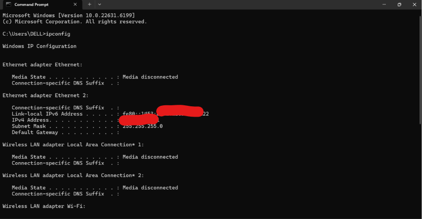
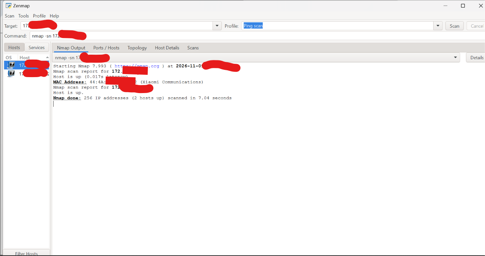
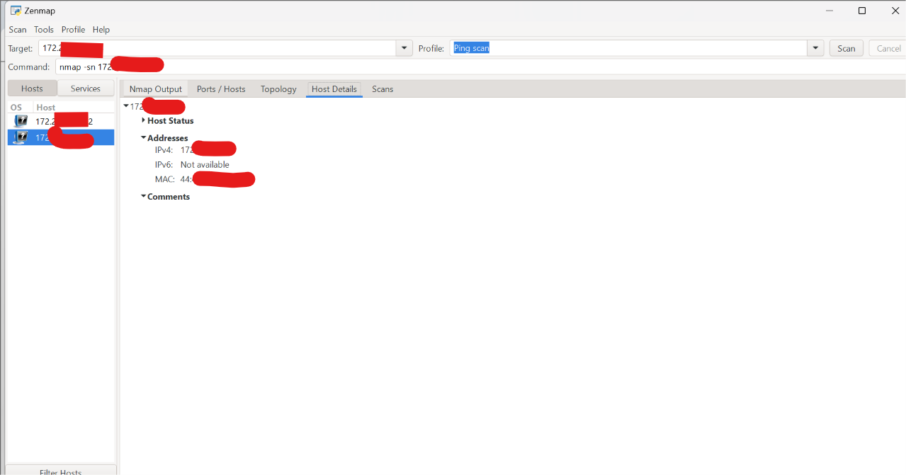
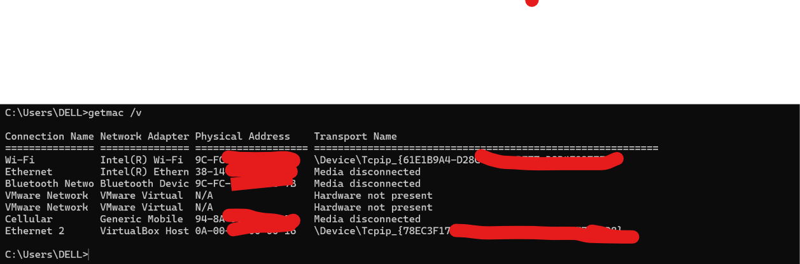
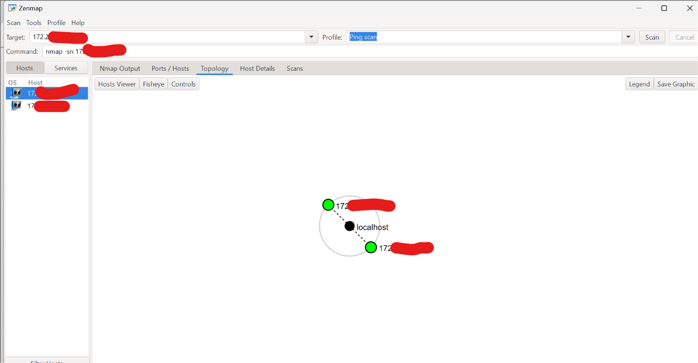

# W2-PM5 — Network Scanning with Zenmap

**Networkwalks Cybersecurity Internship — Week 2**

**Intern:** Abdulmajid Bello  
**Intern ID:** NW-084-2ST  
**Batch:** B0840  
**Date:** November 9, 2026  
**Operating System:** Windows 11  
**Tools:** Zenmap, Nmap, Windows Command Prompt  
**Network:** Privately owned and authorized LAN

---

## Project Overview

This project documents the completion of the seven tasks assigned under W2-PM5: Network Scanning with Zenmap.

The exercise involved installing Zenmap, identifying the local network configuration, discovering active devices, collecting available IP and MAC address information, and generating a network topology diagram.

The assessment was conducted on my privately owned Wi-Fi network. No exploitation or unauthorized testing was performed.

**Privacy note:** Complete IP and MAC addresses have been redacted in the public documentation. Original results are retained privately for verification.

## Task 1 — Download and Install Zenmap

**Objective:** Download and install Zenmap on a Windows computer.

### Procedure

1. Obtained Zenmap through the official Nmap website: https://nmap.org/download.html
2. Installed the software on the Windows host.
3. Launched Zenmap successfully.
4. Confirmed that the interface was operational.

**Result:** Zenmap was successfully installed and used to perform network discovery.

**Evidence:** The functioning Zenmap application is visible in the Task 3 scan screenshot.

---

## Task 2 — Find Local IP Address and LAN Subnet

**Objective:** Determine the Windows host's local IP configuration.

### Command

```cmd
ipconfig
```

### Explanation

The `ipconfig` command displays information about Windows network adapters, including IPv4 addresses, subnet masks, and default gateways.

### Results

| Parameter | Result |
|---|---|
| Network adapter | Wi-Fi |
| IPv4 address | `172.***.***.***` |
| Subnet mask | `255.255.255.0` |
| Network prefix | `/24` |
| LAN subnet | `172.[REDACTED]/24` |
| Default gateway | `172.***.***.***` |

The `/24` subnet contains 256 IPv4 addresses, including the network and broadcast addresses.

**Evidence:**



---

## Task 3 — Find the List of Live Hosts

**Objective:** Discover responding devices within the authorized local network.

### Procedure

1. Opened Zenmap on Windows.
2. Entered the local LAN subnet in the Target field.
3. Selected the **Ping scan** profile.
4. Executed the scan.
5. Examined the discovered hosts and Nmap output.

### Command Structure

```bash
nmap -sn <AUTHORIZED_SUBNET>
```

**Command explanation:**

- `nmap` — Network Mapper, used for network discovery and assessment.
- `-sn` — Performs host discovery without a port scan.
- `<AUTHORIZED_SUBNET>` — The authorized local network being scanned.

The complete subnet is omitted from this public documentation to protect network privacy.

### Results

Zenmap identified two responding hosts:

- **Host A:** Windows scanning laptop.
- **Host B:** Local network gateway.

**Evidence:**



---

## Task 4 — How Many Hosts Are Live?

**Objective:** Determine the total number of responding devices.

### Actual Nmap Result

```text
Nmap done: 256 IP addresses (2 hosts up) scanned in 7.53 seconds
```

| Metric | Result |
|---|---|
| IP addresses scanned | 256 |
| Live hosts detected | 2 |
| Scan duration | 7.53 seconds |
| Nmap version | 7.993 |
| Scan status | Completed |

**Finding:** Two live hosts were discovered during the assessment.

A device that does not respond to discovery probes may not appear in the results. Therefore, the count represents responding hosts at the time of testing.

---

## Task 5 — Identify the IP Addresses of Live Hosts

**Objective:** Record the IP addresses of discovered devices.

### Findings

| Host | Device | IP address |
|---|---|---|
| Host A | Windows laptop | `172.***.***.***` |
| Host B | Network gateway | `172.***.***.***` |

Both devices were detected within the authorized local subnet.

The original IP addresses were recorded during testing but masked for public sharing.

**Evidence:** Zenmap's Hosts panel and Host Details screenshots.

---

## Task 6 — Identify the MAC Addresses of Live Hosts

**Objective:** Record the physical addresses of discovered network interfaces.

### Gateway MAC Address

Zenmap displayed the gateway's MAC address in the **Host Details** tab.

**Result:** Gateway MAC address identified successfully.

### Windows Laptop MAC Address

The laptop's MAC address was not reported in the original Zenmap discovery output. Therefore, Windows Command Prompt was used to retrieve it.

### Command

```cmd
getmac /v
```

### Command Explanation

- `getmac` — Displays physical MAC addresses associated with Windows network adapters.
- `/v` — Requests verbose output with additional adapter information.

### Results

| Host | MAC address | Source |
|---|---|---|
| Host A — Windows laptop | Redacted | Windows `getmac /v` |
| Host B — Network gateway | Redacted | Zenmap Host Details |

Both MAC addresses were obtained for the assessment. Full values have been excluded from the public repository.

### Evidence

**Gateway Host Details**



**Windows MAC Address**



---

## Task 7 — Display and Save Network Topology as PDF

**Objective:** Generate a network topology diagram and save it in PDF format on the Windows Desktop.

### Procedure

1. Opened the **Topology** tab in Zenmap.
2. Examined the discovered hosts in the topology visualization.
3. Identified the two responding network devices.
4. Selected **Save Graphic**.
5. Exported the topology to PDF format.
6. Saved the PDF on the Windows Desktop.

### Findings

The diagram displayed:

- Host A — Windows scanning computer.
- Host B — Network gateway.
- `localhost` — A visualization reference to the scanning system.

The `localhost` reference was not counted as an additional discovered host.

The resulting topology is a graphical representation of the scan results, not a verified physical network layout.

### Evidence

**Topology Screenshot**



**PDF Export**

[View Redacted Network Topology PDF](topology/W2-PM5-Network-Topology.pdf)

---

## Consolidated Results

| Task | Outcome |
|---|---|
| Task 1 — Installation | Zenmap installed and operational |
| Task 2 — Local network | IP configuration and subnet identified |
| Task 3 — Discovery | Two responding devices discovered |
| Task 4 — Host count | 2 live hosts |
| Task 5 — IP addresses | Both host addresses recorded |
| Task 6 — MAC addresses | Gateway MAC from Zenmap; laptop MAC from Windows |
| Task 7 — Topology | Generated and exported as PDF |

**Project Completion: 7 of 7 tasks**

## Security and Privacy Considerations

- The assessment was restricted to a privately owned network.
- Host discovery was performed without port scanning.
- No vulnerability exploitation was attempted.
- Public IP and MAC evidence was redacted to protect local network information.
- Unredacted original evidence was retained privately.
- The results are observations from a specific point in time and may change as devices connect or disconnect.

## Lessons Learned

This exercise strengthened my practical understanding of:

- Windows network configuration.
- IPv4 addressing and subnet masks.
- Nmap and Zenmap host discovery.
- Identifying responsive devices.
- Understanding MAC addresses.
- Using multiple tools to verify network information.
- Interpreting network topology.
- Exporting technical evidence.
- Documenting security assessments professionally while maintaining privacy.

## Conclusion

All seven tasks in W2-PM5 were completed successfully.

Zenmap was used on Windows to investigate an authorized local network containing 256 IPv4 addresses. The Ping Scan identified two responding hosts in 7.53 seconds.

IP addresses were recorded, MAC addresses were identified using Zenmap and Windows tools, and the network topology was exported as a PDF.

The project provided practical experience in network discovery, infrastructure documentation, and responsible security assessment.

---

**Prepared by:** Abdulmajid Bello  
**Batch:** B0840  
**Intern ID:** NW-084-2ST  
**GitHub:** [cYBerLson](https://github.com/cYBerLson)

*For authorized cybersecurity education and defensive network analysis.*